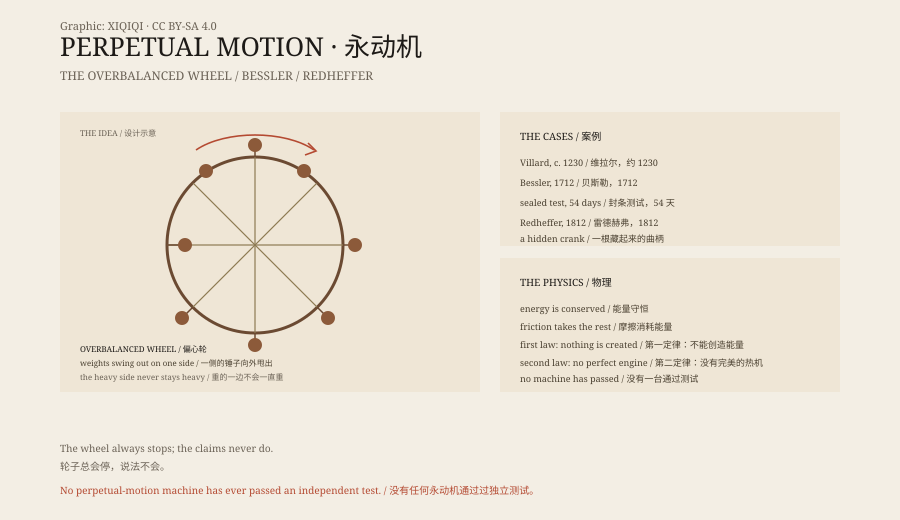

## 一、轮子

十三世纪，法国工匠维拉尔·德·奥内库尔在笔记本上画了一个轮子。

轮子边缘装着铰链，铰链上挂着锤子。轮子转动时，一边的锤子张开，另一边的锤子折起。设计者相信，张开的一边更重，会把轮子一直拉下去。

更早的版本出现在十二世纪的印度。数学家婆什迦罗二世也画过类似的轮子，认为它能自己转动。

这是最早的永动机草图之一。类似的图，在阿拉伯和欧洲的手稿里都出现过。

它们都不转。

## 二、为什么

永动机的想法很简单：不烧煤，不喝水，不靠风，机器自己转，还能带动磨盘和泵。

但物理不允许。能量不会凭空产生。轮子转动时，轴和空气会消耗能量；如果没有任何补充，它只会越来越慢。

中世纪的工匠不知道热力学，但他们能看到轮子停下来。于是他们改进铰链、加重锤子、减小摩擦，再试一次。

## 三、贝斯勒

1712 年，德国人约翰·贝斯勒，自称“奥菲留斯”，造了一台“自转轮”。

他用帆布把轮子盖住，只让观众看外表。轮子能举起重物，能带动泵。他到处表演，名声越来越大。

1717 年，在卡塞尔的魏森施泰因城堡，一台轮子被锁在房间里，门窗贴上封条。五十四天后，封条完好，轮子还在转，每分钟二十六圈。

检查者签了证明：没有发现欺诈。

贝斯勒不肯公开结构。他要价很高，想卖给亲王。后来有女仆指控他造假，他毁了机器，最后在贫困中死去。

他到底怎么做的，没有人知道。有人说他在轮轴里藏了发条，有人说他利用了观众看不到的斜坡，也有人说他只是一个很会表演的骗子。

## 四、雷德赫弗

1812 年，美国人查尔斯·雷德赫弗在费城展出一台机器，收门票。

机器转得很稳，看的人越来越多。雷德赫弗向政府要钱，政府派专家来检查。

工程师罗伯特·富尔顿发现，机器的转速有一点不均匀，像有人在用手摇。

他拆开机器后面的木板，找到一根肠线，顺着线追到楼上的房间。一个老人坐在那里，用手摇曲柄。

观众冲进去，把机器砸了。

## 五、能量

十九世纪，物理学家焦耳、开尔文、亥姆霍兹等人建立了能量守恒定律和热力学。

第一类永动机违反能量守恒：它输出的能量比输入的多。

第二类永动机不违反能量守恒，但违反热力学第二定律：它想把环境里的热全部变成有用的功，而不产生其他变化。

今天，各国专利局基本不接受永动机申请。不是因为他们不相信发明家，而是因为这类机器从来没有一台通过独立测试。

## 六、为什么还在

永动机的故事没有结束。

网络上不断出现“自由能源”、“磁力发电机”、“零消耗”的视频。有些是骗局，有些是误解，有些是测量错误。

它们和贝斯勒的轮子、雷德赫弗的机器没有本质区别：一个看起来违反常识的东西，加上一群愿意相信的人。

轮子会停。物理不会。

*原创示意图：偏心轮结构、贝斯勒与雷德赫弗案例、热力学时间线。不是历史图纸。稀奇奇编辑部，CC BY-SA 4.0。*

---

**来源与许可**：本文的事实来源见条目底部来源台账 S1–S3。文字与原创示意图采用 CC BY-SA 4.0。文中把历史设计、贝斯勒与雷德赫弗的案例、热力学解释分开叙述；永动机违反能量守恒或热力学第二定律，没有任何一台通过独立测试。插图是场景复原，不是历史图纸。
