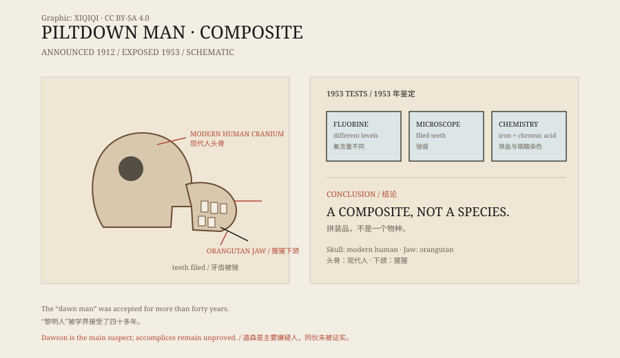

## 1. The discovery of 1912

Piltdown is a small place in East Sussex, England, not far from London.

In 1912, Charles Dawson, an amateur antiquary, found bone fragments in a gravel pit there. He told Arthur Smith Woodward of the British Museum's natural history department.

More fragments followed from the same site: a thick human braincase, an ape-like jaw, several teeth, and some animal fossils and crude stone tools.

They named the creature “Eoanthropus dawsoni” — Dawson's dawn man.

## 2. The skull and the jaw

The reconstructed creature was strange.

The braincase was large, close to a modern human's in capacity. The jaw was ape-like, projecting and without a chin. The wear on the teeth seemed intermediate between human and ape.

At the time it looked like a perfect “missing link”: an early human with a large brain but an ape-like face. It fitted a popular evolutionary picture in which the brain expanded first, and upright walking and tool use came later.

*Original schematic: how the Piltdown fossils were assembled and the lines of evidence used in 1953. Not a historical photograph. Oddity Archive, CC BY-SA 4.0.*

## 3. Why people believed it

Piltdown was not a careless invention.

Dawson and Woodward were experienced, and the bones came with a plausible site, stratigraphy, and associated finds. Dating techniques were still primitive, and there was no reliable way to tell whether the bones were the same age.

More importantly, it matched what some scholars wanted. Britain needed its own early human fossil, and Piltdown filled the gap. Doubts were raised, but for a long time they did not become mainstream.

## 4. Forty years

Piltdown entered textbooks, museums, and popular accounts.

It was placed on the human family tree and influenced discussions about the order in which the brain and the jaw evolved. Generations of students looked at the reconstructed skull and took it as part of the human past.

It was not flawless. Some noticed that the jaw and skull joined awkwardly, and that the tooth wear was odd. But the doubts did not add up to decisive evidence.

## 5. Exposure

In 1953, the case collapsed.

Kenneth Oakley of the British Museum, Joseph Weiner of Oxford, and Wilfrid Le Gros Clark re-examined the fossils with fluorine dating and other methods.

Fluorine dating can estimate how long bones have been buried. The results showed that the skull and jaw had very different fluorine levels. They could not have come from the same individual, or from the same period.

Further examination showed that the skull was modern human, the jaw was orangutan, the teeth had been filed by hand, and the bones had been stained with iron salts and chromic acid to look fossilised. It was a composite.

## 6. Who did it

Charles Dawson is the main suspect.

He had motive and opportunity: he wanted academic recognition from a major discovery. Whether he had accomplices has never been settled. Suggestions have included colleagues, a French palaeontologist, and even Arthur Conan Doyle, but none has been proved.

The lesson of Piltdown is direct: evidence that fits a theory too perfectly may be worth a second look precisely because it is so perfect.

---

**Sources and licenses**: the factual sources are listed in the source ledger S1–S3 at the bottom of this entry. Text and original diagrams are licensed under CC BY-SA 4.0. This article separates the discovery, its scientific reception, the 1953 examination, and the speculation about who was responsible; the culprit is still disputed, and Dawson is the main suspect rather than the only one.
