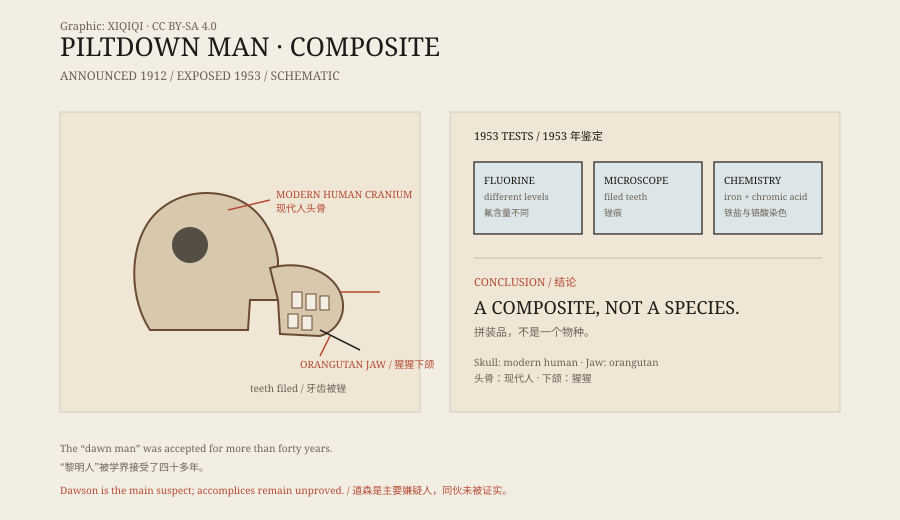

## 一、1912 年的发现

皮尔当是英格兰东萨塞克斯的一个小地方，离伦敦不远。

1912 年，业余古物研究者查尔斯·道森在这里的砾石坑里发现了一些骨头碎片。他把消息告诉了英国自然历史博物馆的亚瑟·史密斯·伍德沃德。

随后，他们又在同一地点找到了更多碎片：一块厚实的头骨、一段像猿的下颌、几颗牙齿，还有一些动物化石和粗陋的石器。

他们把这种生物命名为“Eoanthropus dawsoni”，意思是“道森的黎明人”。

## 二、头骨和下颌

拼出来的样子很特别。

头骨很大，脑容量接近现代人；下颌却像猿，突出、没有下巴。牙齿的磨损方式也介于人和猿之间。

在当时，这看起来像一个完美的“缺失环节”：一个脑子已经变大、但脸还像猿的早期人类。它正好符合一种流行的进化想象——大脑先变大，直立行走和工具使用随后才出现。

*原创示意图：皮尔当人化石的拼装方式与 1953 年的鉴定线索。不是历史照片。稀奇奇编辑部，CC BY-SA 4.0。*

## 三、为什么有人相信

皮尔当人不是随便编出来的。

道森和伍德沃德都是有经验的人，化石出土的地点、层位和伴随物都像模像样。当时的年代测定技术还很原始，没有可靠的方法判断骨头是否同一时代。

更重要的是，它符合当时部分学者的期待。英国需要一个自己的早期人类化石；皮尔当正好填上了这个位置。质疑的声音出现过，但长期没有成为主流。

## 四、四十年

皮尔当人进入了教科书、博物馆和科普读物。

它被当作人类进化树上的一个分支，影响了关于大脑和下颌演化顺序的讨论。几代学生看着那张拼出来的头骨，以为这就是人类的过去。

它不是没有破绽。有人注意到下颌和头骨的接合不自然，牙齿的磨损也不对劲。但这些疑问没有形成决定性的证据。

## 五、揭穿

1953 年，事情到了尽头。

英国博物馆的肯尼斯·奥克利、牛津大学的约瑟夫·韦纳和威尔弗里德·勒格罗斯·克拉克用氟测定和其他方法重新检查了化石。

氟测定可以判断骨头埋藏了多久。结果显示，头骨和下颌的氟含量差别很大，不可能来自同一个个体，也不可能来自同一时代。

进一步的检查发现：头骨属于现代人，下颌属于猩猩；牙齿被人工锉过，骨头被铁盐和铬酸染成深色，看起来像化石。这是一件拼装品。

## 六、谁做的

查尔斯·道森是主要嫌疑人。

他有动机，也有机会：他希望通过发现获得学术声望。但有没有同伙，至今没有定论。各种猜测包括他的同事、一位法国古生物学家，甚至《福尔摩斯》的作者柯南·道尔，但都缺乏确证。

皮尔当人留下的教训很直接：一件“完美符合理论”的证据，可能正因为太完美，而值得多看一眼。

---

**来源与许可**：本文的事实来源见条目底部来源台账 S1–S3。文字与原创示意图采用 CC BY-SA 4.0。文中把化石发现、当时的学术接受、1953 年鉴定与嫌疑人猜测分开叙述；“谁做的”仍存在争议，道森是主要嫌疑人，但并非唯一被猜测的人。
