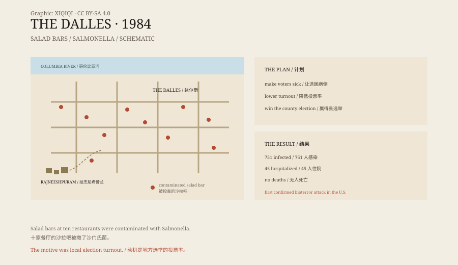

## 1. The Dalles

The Dalles is a small town in Oregon, on the Columbia River.

In the 1980s, a large religious community called Rajneeshpuram was built on land nearby. Its leader was the Indian spiritual teacher Bhagwan Shree Rajneesh, later known as Osho.

The community had its own farm, school, airstrip, and armed guards. It was in conflict with the town over land, water, and votes.

## 2. The election

In 1984, Wasco County held local elections.

The Rajneeshee community wanted to put its own candidates into the county government, so that it could control local law enforcement and land policy. But its members knew the town's residents would not vote for them.

So the community's inner circle came up with a plan: make the town's voters sick on election day so they would stay home. Turnout would fall, and the community's own candidates would win.

## 3. The poisoning

They chose Salmonella.

The community had a medical laboratory, and its members cultured the bacteria there. From September to October 1984, they carried it into town and put it on salad bars, coffee creamers, and food at ten restaurants.

Within days, The Dalles began to see a wave of diarrhea, fever, and abdominal pain. The hospital filled up, schools closed, and people assumed the water supply was to blame.

The final count: 751 people infected, 45 hospitalized, no deaths.

*Original schematic: the town of The Dalles, the affected restaurants, the timeline, and the investigation. Not an epidemiological map. Oddity Archive, CC BY-SA 4.0.*

## 4. The investigation

At first, the health department assumed it was ordinary food poisoning.

They checked restaurant kitchens, the water supply, and the food chain, and found no clear cause. When the Centers for Disease Control became involved, they noticed that the cases were spread across different restaurants but concentrated on salad bars.

The break came from another investigation. The FBI was already looking into other crimes by the Rajneeshee community. In 1985, investigators found a vial of Salmonella in the community's laboratory. The strain matched the one in the patients.

## 5. The trial

In 1985, the community's inner circle was arrested.

Ma Anand Sheela, the community's effective manager, was charged with planning the poisoning, arson, and attempted murder. She pleaded guilty and was sentenced to twenty years; she was released after serving twenty-nine months.

Bhagwan himself was not charged with the poisoning. He pleaded guilty to immigration violations, was fined and deported, and died in India in 1990.

The community dissolved, and its land was sold. The Dalles returned to quiet.

## 6. Now

The attack is regarded as the first confirmed bioterrorist attack in U.S. history, and the largest.

It changed the way the United States thought about biosecurity. Public health agencies began training staff to recognise deliberately introduced disease, and laboratory rules for dangerous pathogens became stricter.

The Dalles has no monument to the attack. What people remember is the panic of those weeks, and the truth that emerged later: what made them sick was not spoiled food, but a decision made by a group of people who wanted to win an election.

---

**Sources and licenses**: the factual sources are listed in the source ledger S1–S3 at the bottom of this entry. Text and original diagrams are licensed under CC BY-SA 4.0. This article separates the town's background, the election motive, the poisoning, the investigation, and the trial; the counts come from public health investigations, and the sentences and release dates are recorded in the sources.
