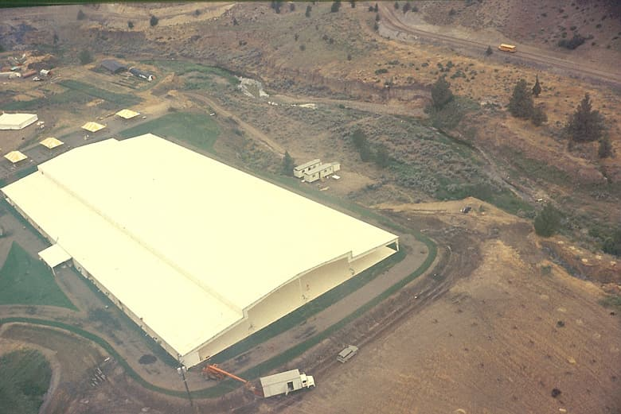
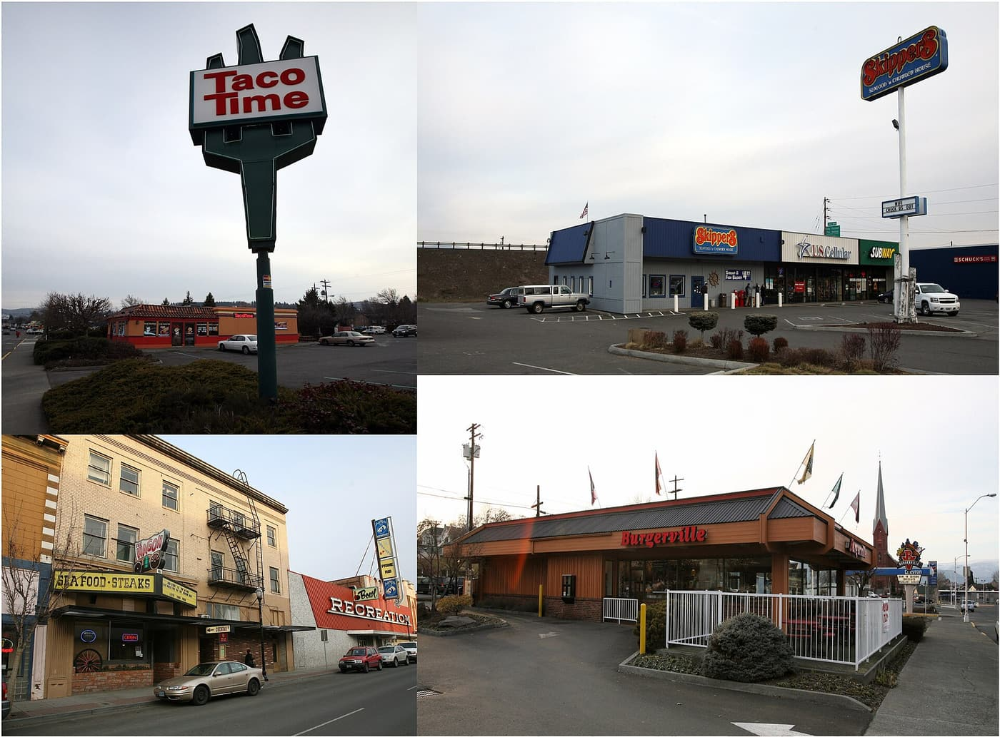
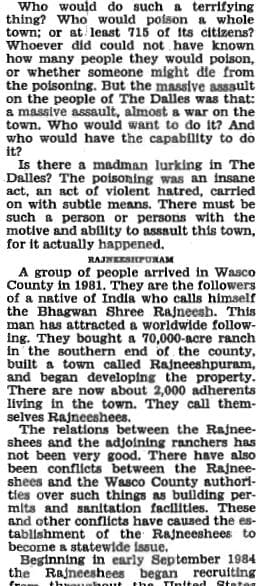
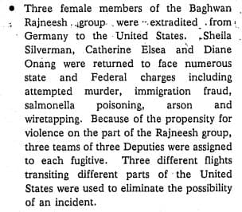
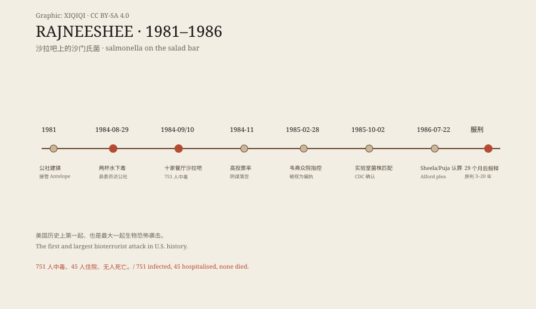

## 一、一个县的两席

1981 年，几千名拉杰尼希（后称奥修）的追随者搬进俄勒冈州沃斯科县的"大泥牧场"，建起公社"拉杰尼希普拉姆"。他们接管了旁边只有 75 人的小镇安特洛普，把镇名改成"拉杰尼希"。起初与邻居友好，很快因土地用途与扩张速度翻脸。

建筑许可被拒后，公社领导层想把政治控制扩展到全县：目标是 1984 年 11 月选举中拿下县委员会三席中的两席，以及警长办公室。公社的日常景观本身就是一场宣传：拉杰尼希每天乘劳斯莱斯车队"drive-by"，信徒列队迎接。他们先搞"分享一个家"计划，把数千名无家可归者运进公社、试图登记他们投票；县书记官用一条"新选民须提交资格证明"的规定挡住了这条路。

*历史照片：1985-10-10，Ted Quackenbush，GFDL 1.2（Wikimedia Commons）。航拍公社的大型白色屋顶建筑与周围旱地。*

## 二、"salsa"

剩下的路是让选民病倒。达尔斯是沃斯科县人口最多的镇，票仓在那里。

1984 年 8 月 29 日，两名来访的县委员在公社喝下含沙门氏菌的水，双双病倒、一人住院。这是试验。随后成员把菌液抹在杂货店农产品上、县法院的门把手与小便池把手上——效果不理想。9 月到 10 月，他们转向十家餐厅的沙拉吧：一名成员藏着装有浅棕色菌液的塑料袋（内部叫它"salsa"），抹在食物上或倒进沙拉酱。

751 人中毒，45 人住院，无人死亡。受害者从一名出生两天、最初存活率被判只有 5% 的婴儿，到一名 87 岁老人。症状是腹泻、发烧、寒战、呕吐、腹痛与血便。

*现场照片：2008 年 1 月，Cacophony，CC BY 3.0（Wikimedia Commons）。四家受影响餐厅的外观：Taco Time 招牌、商业街店面与海鲜牛排馆等。*

## 三、选举日反而投票率高

本地居民怀疑是公社下的手。选举日那天，他们成群出门投票，阻止公社赢得任何县职——阴谋因此落空。公社最终撤回候选人；七千名居民里只有 239 人投票，多数不是美国公民、本就不能投。

疫情让当地餐厅损失数十万美元，卫生官员关掉了受影响店的沙拉吧。有居民害怕再被下手，待在家里。一位居民说："人们又惊又怕。不敢出门，不敢单独出门。人变成了囚徒。"

## 四、一个议员的固执

最初调查把疫情归因于食品从业者个人卫生差——餐厅员工确实比顾客先病。俄勒冈民主党众议员吉姆·韦弗不接受这个解释。他联系 CDC 与其他机构，催促调查公社；许多人把他的担心当作偏执，或当作"抹黑拉杰尼希派"。

1985 年 2 月 28 日，他在众议院发表演讲，指控拉杰尼希派在八家餐厅的沙拉吧原料上撒沙门氏菌培养物。演讲页开头是一连串问句："谁会做这么可怕的事？谁会毒害一整座镇——至少是它的 715 名市民？"当时数字还是 715，后来定为 751。他的论证当时只有间接证据；几个月后调查进入公社，这些间接环节被逐一证实。

*档案文件：1985-02-28，众议员 James H. Weaver 演讲印页，公有领域（Wikimedia Commons）。开头问句与"RAJNEESHIPURAM"小节标题清晰可见。*

## 五、实验室里的匹配

1985 年 9 月 16 日，结束四年公开沉默的拉杰尼希召开记者会：说希拉与另外十九名公社领导周末逃往欧洲；称他们为"法西斯团伙"；指控他们毒害他的医生、他的女伴、杰斐逊县地方检察官与达尔斯供水系统，并怀疑他们与沙门氏菌疫情有关。他邀请州与联邦执法进公社调查。

10 月 2 日，50 名调查员进入牧场。州公共卫生实验室主任斯基尔斯在公社医疗诊所实验室找到含沙门氏菌的玻璃瓶与菌片（bactrol disks）；CDC 亚特兰大实验室确认：公社实验室的菌株与让镇民中毒的菌株完全匹配。调查还发现《无政府主义者食谱》、炸药与军用生物战文献，以及一张 1984 年 9 月 25 日美国典型培养物保藏中心的发票——订购的是伤寒沙门氏菌。另有一桩未遂的刺杀联邦检察官计划被一并揭出。

*档案文件：1986-09-30，美国法署报告页，公有领域（Wikimedia Commons）。记三名女成员自德国引渡、罪名含未遂谋杀与沙门氏菌投毒，并为每人派三组法警、分三架航班押送。*

## 六、二十九年与二十个月

希拉与普雅 1985 年 10 月 28 日在西德被捕，经漫长谈判于 1986 年 2 月 6 日引渡到波特兰。法警报告记下了押送的谨慎：每名逃犯派三组、每组三名法警，分三架经不同航线的航班，以排除任何意外。1986 年 7 月 22 日，两人以 Alford 认罪（不承认罪责但接受刑罚）应对投毒等指控，刑期三到二十年不等；实际服刑二十九个月后因表现良好假释。希拉绿卡被吊销，移居瑞士，再婚，后来经营两家养老院。

拉杰尼希 1985 年 10 月 27 日离境时在北卡罗来纳被捕，以移民罪名认罪协议结案：缓刑十年、罚款四十万美元、驱逐出境。他从未因沙门氏菌袭击被起诉。他是否知情，始终没有被证明——追随者相信他知情，或相信他完全不知情，两种信念都没有证据落地。

*原创示意图：从建镇、下毒、高投票率挫败阴谋到菌株匹配与认罪的时间线。稀奇奇编辑部，CC BY-SA 4.0。*

## 七、沙拉吧

这桩袭击的武器不是枪、不是炸弹，是沙拉吧：生菜、番茄、沙拉酱、自助夹子。它选择的目标不是杀人，是让一个县的选民在某个星期二站不起来。它失败于同一群人的相反动作——成群出门投票。

今天达尔斯的餐厅照常营业，沙拉吧照常摆着。没有人再往里面倒"salsa"。但 1984 年的那几个月证明了一件事：最普通的公共信任设施，也可以被当作武器；而守住它的，是另一群普通人决定照常出门。

---

**来源与许可**：事实来源见台账 S1–S6。文字与原创示意图 CC BY-SA 4.0。演讲页与法警报告为美国政府公有领域文件；餐厅与公社照片为 Wikimedia Commons 署名作品，许可见台账。拉杰尼希是否知情未被证明，本文并列呈现两种信念而不裁定。