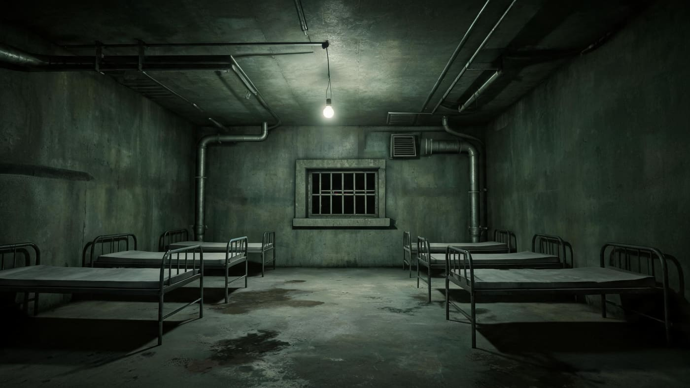
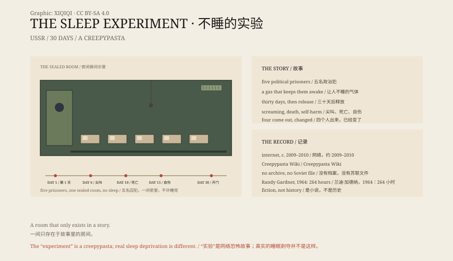

## 1. The Story

The 1940s, Soviet Union. Scientists seal five political prisoners in a chamber.

The room has beds, food, a toilet, and a gas that keeps them awake.

There were no windows, only an observation pane and a microphone. The light stayed on, so day and night could not be told apart. When the five were taken inside, the door closed behind them and the lock clicked.

The deal: stay awake for thirty days, and you will be released.

Outside the door, the notebook was neat for the first few days: when they ate, when they spoke, who stood by the window for a long time. By the sixth day, the handwriting began to loosen.

*Reconstruction: the sealed observation room in the story. This is an internet horror story, not a historical site. Oddity Archive, CC BY-SA 4.0.*

## 2. The Sixth Day

The story says that on the sixth day the microphones began to pick up screaming.

On the tenth day one of them died. The others hid the body in the wall.

By the fifteenth day they were tearing at their own skin, saying, "We don't need sleep."

## 3. The Door

On the thirtieth day the scientists opened the room.

Four were alive, but no longer human. They demanded to be put back in the gas and to continue the experiment.

One scientist said he was quitting. The four tore him apart.

## 4. The Source

This is not an archive.

It appeared on the English-language internet around 2009–2010, was collected on the Creepypasta Wiki, and was translated into many languages.

It imitates the form of reports, recordings and laboratory notes, which is why it looks real.

## 5. Real Sleep Deprivation

Real sleep deprivation experiments were far milder.

In 1964 the American teenager Randy Gardner stayed awake for 264 hours, setting a record. He experienced mood changes, poor concentration and hallucinations, but he did not become a monster.

Long-term sleep loss damages cognition, but it does not turn people into what the story describes.

## 6. Why It Works

The story works because it stacks several fears together: state power, medicine, confinement and insomnia.

There are no ghosts and no aliens. There is one room, and five people becoming less human.

The worst part is that you do not know what day you would become something else.

*Original schematic: the thirty days of the story, the internet timeline and the real records of sleep deprivation. Not a historical photograph. Oddity Archive, CC BY-SA 4.0.*

---

**Sources and licenses**: the factual sources are listed in the source ledger S1–S4 at the bottom of this entry. Text and original diagrams are licensed under CC BY-SA 4.0. This article separates the internet horror story, real sleep deprivation research and the historical claim of a "Soviet experiment"; no archive or physical evidence supports the story. The illustration is a scene reconstruction, not a historical photograph.
