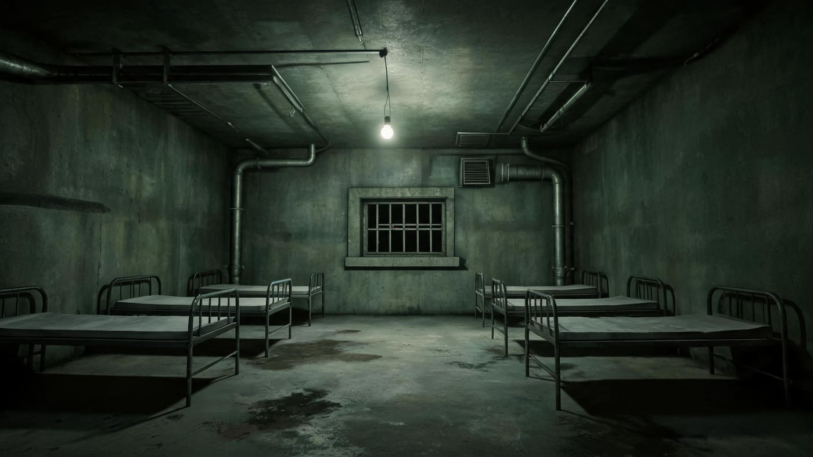
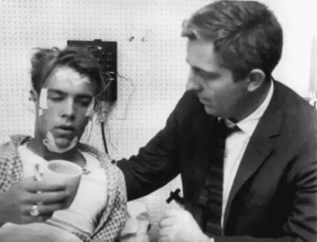
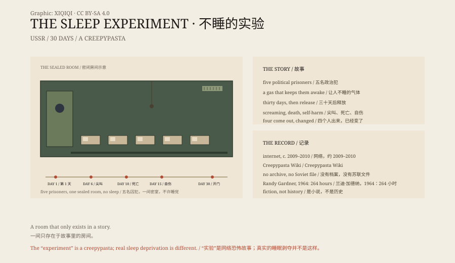

## 1. The Story

The 1940s, Soviet Union. A group of scientists seal five political prisoners in a room.

The room has a bed, food, a latrine, and a gas that is fed in continuously to keep them awake. There is no window, only an observation pane and a microphone. The lights stay on. Day and night lose their shape. The five are taken in, the door closes behind them, and the bolt sounds.

The terms: thirty days without sleep. Survive, and they go free.

On the clipboard outside, the first days are neat: when they ate, when they spoke, who stood by the pane for a long time. By the sixth day the handwriting is going wrong.

*Reconstruction: the sealed observation room of the story. This is an internet horror story, not a historical site. XIQIQI Editorial, CC BY-SA 4.0.*

## 2. The Sixth Day

On the sixth day, the story says, the microphone begins to pick up screaming.

On the tenth day one of them dies. The others hide the body in the wall, filling the gap with torn cloth and waste.

On the fifteenth day they begin to tear at their own skin and say, "We do not need sleep." The observation pane is covered in handprints. The gas keeps flowing.

Outside, the scientists are afraid. They do not open the door. They keep taking notes.

## 3. The Thirtieth Day

On the thirtieth day, the scientists open the room.

Four are still alive, but not human. They ask the scientists to continue the experiment, to put them back in the gas. One scientist says he wants out. The four tear him apart and eat him.

Only the narrator survives. He is the one who has been keeping the record.

The story has no ending. It has a series of entries, and a sentence that gets shorter and shorter: "We do not need sleep."

## 4. Where It Comes From

The story is not an archive.

It is a creepypasta. On 16 August 2010 a user called OrangeSoda posted it to the Creepypasta Wiki; the real name is unknown. The wiki's revision logs show that it first appeared on 4chan's /x/ board. Snopes, news.com.au and LiveAbout later traced and debunked it, and it was translated into many languages.

It imitates the form of a report, a recording, an experiment log. That is why it reads as true. There is no author's name, no archive number, no laboratory address, no real person to check. What it has is dates, a room number, an observation pane, a microphone, a clipboard. Those details make the reader believe they are holding a leaked file.

## 5. The Photograph

The story is usually shared with a photograph: an emaciated figure, skin against bone, enormous eyes, standing in the dark.

The photograph is not an experiment. It is an animatronic Halloween prop called "Spazm", sold as a horror decoration.

A prop photograph, a paragraph with no provenance, and the "Russian Sleep Experiment" has its "evidence". This is the standard method of internet horror: give the reader an image, and let them supply the background. The photograph is copied and recopied until the image quality falls apart, which only makes it look more like an old file.

## 6. Real Sleep Deprivation

Real sleep-deprivation experiments were milder.

In 1964 the American high-school student Randy Gardner, supervised by two researchers, stayed awake for 264 hours, eleven days, a record at the time. He became moody, his attention dropped, his short-term memory failed, and he hallucinated. In the last days his speech slowed and his reactions dulled. At the end of the experiment he slept for more than a dozen hours and largely recovered.

*Historical photograph: Randy Gardner drinking water after 264 hours without sleep, 1964. Public domain (Wikimedia Commons). The electrodes monitored his brain activity.*

Long sleep deprivation damages cognition and affects the immune and metabolic systems; in extreme cases it can kill. But no record shows it turning a person into what the story describes: tearing their own skin, eating people, asking to be put back in the gas.

Hallucinations usually arrive on the third or fourth day: seeing things that are not there, hearing voices, feeling someone standing in the room. The symptoms are reversible. They are not a transformation.

What is more dangerous than the hallucinations is microsleep: the brain shutting down for a few seconds while the person believes they are awake. Often they do not notice. At the wheel or at a machine, a few seconds are enough.

## 7. Why It Is Frightening

The story is popular because it stacks several fears on top of one another: state power, medicine, a sealed room, sleeplessness. It stitches a political fear to a bodily one: the state will not let you sleep, and your body will not let you sleep.

The state can lock a person up in the name of science. A doctor can watch you come apart, taking notes, not intervening. The room has no window, the light never goes off, time loses its shape. At the end you do not recognise yourself.

There is no ghost and no alien. There is a room, and five people becoming less human.

The worst part is that you do not know what day you will become something else.

## 8. Afterwards

The story has been adapted many times.

A novel inspired by it appeared in 2015 and is now out of print. In 2019 a play, Subject UH1317 - When Science Traces A Deadly Turn, was staged. A psychological thriller began production in Ireland in 2018 and was released in November 2022. In July 2019 the horror novelist Jeremy Bates published The Sleep Experiment. A film, The Soviet Sleep Experiment, starring Chris Kattan and directed by Barry Andersson, was shot in Lakeville, Minnesota, in 2018.

Each version adds something: more blood, more monsters, more "files". The core does not change: five people, one room, thirty days.

On the thirtieth day the door opens. The one who kept the record is still alive. He writes the last line and leaves the story to the internet.

*Original schematic: the thirty days of the story, the online timeline and the real sleep-deprivation record. Not a historical photograph. XIQIQI Editorial, CC BY-SA 4.0.*

---

**Sources and licenses**: Text and original diagrams are licensed CC BY-SA 4.0; third-party image and source licences are listed in the source ledger below.
