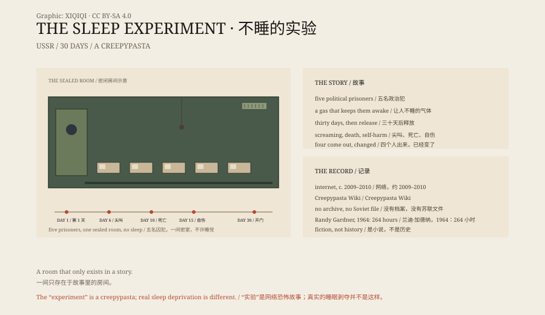

## 一、故事

1940 年代，苏联。一群科学家把五名政治犯关进一间密封的房间。

房间里有一张床、食物、厕所，还有持续释放的兴奋气体。

条件：三十天不睡觉。只要撑过去，就放他们走。

## 二、第六天

故事说，第六天，房间里的麦克风开始传出尖叫。

第十天，一个人死了。剩下的人把尸体藏在墙里。

第十五天，他们开始撕自己的皮肤，说“我们不需要睡觉”。

## 三、打开

第三十天，科学家打开房间。

四个人还活着，但不像人。他们要求科学家继续实验，把他们放回气体里。

其中一个科学家说，他要退出。四个人把他撕了。

## 四、来源

这个故事不是档案。

它大约在 2009 到 2010 年间出现在英文网络，后来被收进 Creepypasta Wiki，再被翻译成各种语言。

它模仿了报告、录音和实验记录的格式，所以看起来像真的。

## 五、真的睡眠剥夺

真实的睡眠剥夺实验要温和得多。

1964 年，美国少年兰迪·加德纳连续 264 小时不睡，创下记录。他出现了情绪波动、注意力下降和幻觉，但没有变成怪物。

长期不睡会损害认知，但不会让人变成故事里的那种东西。

## 六、为什么

这个故事之所以流行，是因为它把几个恐惧叠在一起：国家权力、医学、密闭空间、失眠。

它没有鬼，也没有外星人。它只有一间房间，和五个越来越不像人的人。

最可怕的部分，是你不知道自己在不睡的第几天会变成什么。

*原创示意图：故事中的三十天、网络传播时间线与真实的睡眠剥夺记录。不是历史照片。稀奇奇编辑部，CC BY-SA 4.0。*

---

**来源与许可**：本文的事实来源见条目底部来源台账 S1–S4。文字与原创示意图采用 CC BY-SA 4.0。文中把网络恐怖故事、真实睡眠剥夺研究与“苏联实验”的历史说法分开叙述；没有任何档案或实物证据支持这个故事。插图是场景复原，不是历史照片。
