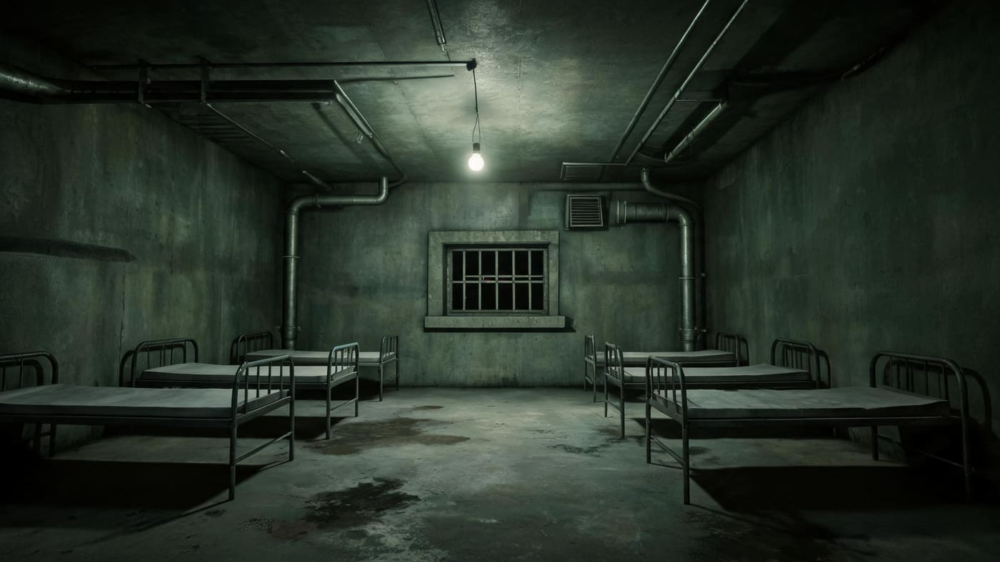
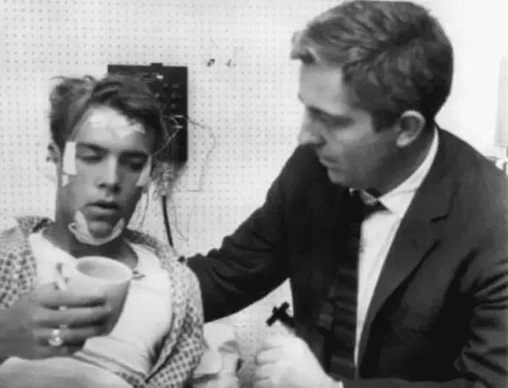
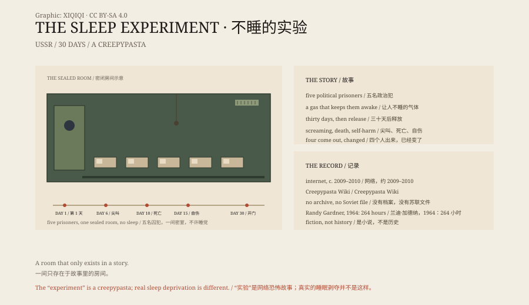

## 一、故事

1940 年代，苏联。一群科学家把五名政治犯关进一间密封的房间。

房间里有一张床、食物、厕所，还有持续释放的兴奋气体。房间没有窗户，只有一扇观察窗和一只麦克风。灯一直亮着，分不清白天和黑夜。五个人被带进去时，门在身后关上，锁舌响了一声。

条件：三十天不睡觉。只要撑过去，就放他们走。

门外的记录本上，最初几天写得很整齐：几点吃饭，几点说话，谁在窗边站了很久。到第六天，字迹开始乱。

*场景复原：故事里那间密封的观察室。这是一个网络恐怖故事，不是历史现场。稀奇奇编辑部，CC BY-SA 4.0。*

## 二、第六天

故事说，第六天，房间里的麦克风开始传出尖叫。

第十天，一个人死了。剩下的人把尸体藏在墙里，用撕下来的衣服和排泄物把缝糊住。

第十五天，他们开始撕自己的皮肤，说“我们不需要睡觉”。观察窗上全是手印。气体还在往里送。

外面的科学家开始害怕。他们不敢开门，只能继续记录。

故事里的日期不是随机的：第六天、第十天、第十五天、第三十天，每隔几天一个台阶，恐惧一级一级往上走。读者被这些数字带着走，来不及问一句“为什么”。

## 三、第三十天

第三十天，科学家打开房间。

四个人还活着，但不像人。他们要求科学家继续实验，把他们放回气体里。其中一个科学家说，他要退出。四个人把他撕了，吃了他。

最后只有叙述者活了下来。他是那个一直在记录的人。

这个故事没有结尾。它只有一段一段的记录，和一个越来越短的句子：“我们不需要睡觉。”记录本上最后一页是空白的。

## 四、它从哪里来

这个故事不是档案。

它是一篇网络恐怖小说（creepypasta）。2010 年 8 月 16 日，一个叫 OrangeSoda 的用户把它上传到 Creepypasta Wiki，真实姓名不明。维基的修订记录显示，它最初出现在 4chan 的 /x/ 版。后来它被 Snopes、news.com.au、LiveAbout 等媒体追踪、辟谣，再被翻译成各种语言。

它模仿了报告、录音和实验记录的格式，所以看起来像真的。它没有作者署名，没有档案编号，没有实验地点，也没有任何一个可以核对的真实人名。它有的是日期、房间号、观察窗、麦克风和记录本——这些细节让读者以为自己在看一份泄露的文件。

## 五、那张图

这个故事常常配着一张图：一个瘦得只剩骨架的人，皮肤贴着骨头，眼睛很大，站在黑暗里。

那张图不是实验照片。它是一个万圣节电子人偶（animatronic），名字叫“Spazm”，是市面上卖的恐怖道具。

一张道具照片，配上一段没有出处的文字，就成了“苏联睡眠实验”的“证据”。这是网络恐怖故事的标准做法：先给你一个画面，再让你自己补上背景。这张照片在网上被反复复制，画质越来越差，反而更像旧档案。

## 六、真的不睡

真实的睡眠剥夺实验要温和得多。

1964 年，美国加州圣地亚哥的高中生兰迪·加德纳（Randy Gardner）在两位研究者陪同下，连续 264 小时（11 天）不睡，创下当时的记录。他出现了情绪波动、注意力下降、短期记忆出错和幻觉；最后几天，他说话变慢，反应变迟钝。实验结束时，他睡了十几个小时，然后基本恢复。

*历史照片：1964 年，兰迪·加德纳在连续 264 小时不睡之后喝水。公有领域（Wikimedia Commons）。照片里的电极用于监测他的脑电活动。*

长期不睡会损害认知，影响免疫和代谢，极端情况下可能致命。但没有任何记录显示，不睡会让人变成故事里的那种东西：撕自己的皮肤，吃人，要求继续实验。

睡眠剥夺的幻觉通常出现在第三到第四天：看到不存在的东西，听到声音，觉得有人站在房间里。这些症状是可逆的，也不是“变身”。

比幻觉更危险的是微睡眠（microsleep）：大脑在你以为清醒的时候短暂关机几秒，人自己往往察觉不到。开车、操作机器时，几秒钟就够了。

## 七、为什么可怕

这个故事之所以流行，是因为它把几个恐惧叠在一起：国家权力、医学、密闭空间、失眠。它把政治恐惧和身体恐惧缝在一起：国家不让你睡，身体也不让你睡。

国家可以把人关起来，以“科学”的名义。医生可以看着你坏掉，只记录，不救。房间没有窗，灯一直亮，时间失去形状。最后，你连自己都不认识。

它没有鬼，也没有外星人。它只有一间房间，和五个越来越不像人的人。

最可怕的部分，是你不知道自己在不睡的第几天会变成什么。

## 八、后来

这个故事被改编了很多次。

2015 年，一本受它启发的小说出版，后来绝版。2019 年，一出叫《Subject UH1317 - When Science Traces A Deadly Turn》的舞台剧上演。2018 年，一部心理惊悚片在爱尔兰开拍，2022 年 11 月上映。2019 年 7 月，恐怖小说家杰里米·贝茨（Jeremy Bates）出版了《The Sleep Experiment》。还有一部叫《The Soviet Sleep Experiment》的电影，由克里斯·卡坦（Chris Kattan）主演、巴里·安德森（Barry Andersson）执导，2018 年在明尼苏达州莱克维尔拍摄。

每一版都在加东西：更多的血，更多的怪物，更多的“档案”。但故事的核心没有变：五个人，一间房，三十天。

第三十天，门打开了。记录的人还活着。他写下最后一行，然后把这个故事留给了网络。

*原创示意图：故事中的三十天、网络传播时间线与真实的睡眠剥夺记录。不是历史照片。稀奇奇编辑部，CC BY-SA 4.0。*

---

**来源与许可**：事实来源见条目底部来源台账 S1–S4。文字与原创示意图采用 CC BY-SA 4.0。文中把网络恐怖故事、道具照片、真实睡眠剥夺研究与“苏联实验”的历史说法分开叙述；没有任何档案或实物证据支持这个故事。插图是场景复原、历史照片与示意图，不是事件现场照片。
