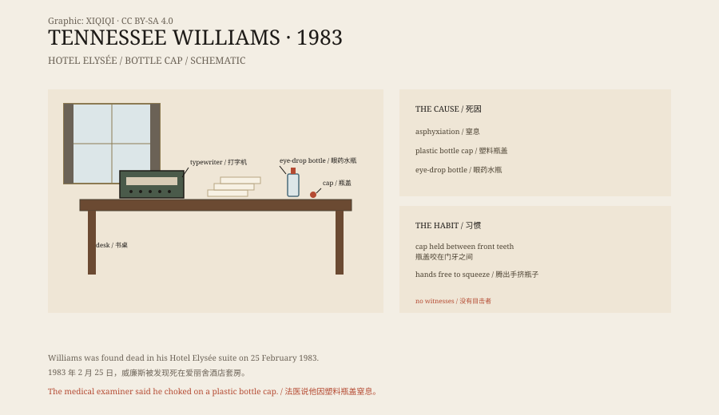

## 1. 25 February 1983

New York, 60 East 54th Street, the Hotel Elysée.

Tennessee Williams had been living there for some time. He treated the hotel as his home, and his room was full of books, medicine bottles, papers, and a typewriter.

On 25 February he did not appear as usual. Hotel staff opened the door and found him on the floor, not breathing.

He was 71.

## 2. The bottle cap

The medical examiner's initial report said he died of asphyxiation.

A plastic bottle cap was lodged in his throat. It came from the eye-drop bottle he used regularly. He had a habit: while putting in the drops, he held the cap between his upper and lower front teeth so that his hands were free to squeeze the bottle.

This time, the cap slipped down his throat.

Later reports and autopsy records noted that he had also been taking barbiturates. The drugs may have slowed his reactions, so that he could not cough the cap out.

*Original schematic: the timeline of 25 February 1983, the bottle cap and eye-drop bottle, and the layout of the hotel room. Not a photograph of the scene. Oddity Archive, CC BY-SA 4.0.*

## 3. His life

Tennessee Williams was born Thomas Lanier Williams in Mississippi in 1911.

He wrote The Glass Menagerie, A Streetcar Named Desire, and Cat on a Hot Tin Roof. These plays made him famous on Broadway and won him Pulitzer Prizes. His characters struggle with desire, memory, and failure.

In his later years his work was no longer as popular. He depended on alcohol and drugs, suffered from depression, and was hospitalised several times. He kept writing, but critics grew colder towards his new plays.

## 4. The question

The most puzzling thing is not the bottle cap, but why he had it in his mouth.

He lived alone, and there were no signs of a struggle. The police did not suspect murder. The medical examiner concluded accidental asphyxiation.

But why would a 71-year-old man hold a bottle cap between his teeth while using eye drops? Was it habit, a tremor, or the drugs? There is no certain answer.

His death became a strange full stop: a playwright who wrote about desire and failure was carried off by a small piece of plastic.

## 5. Afterwards

He was buried in St. Louis.

His plays are still performed. The line from A Streetcar Named Desire — “I have always depended on the kindness of strangers” — became one of the most quoted lines in English.

The Hotel Elysée is still open. The room he lived in was later turned into a suite named after him.

## 6. Now

Today, Tennessee Williams's death is still told as a curiosity, a “writer's death”.

But it is also a reminder that a life can fill a stage and still be ended by something tiny. One bottle cap, one breath, one second.

---

**Sources and licenses**: the factual sources are listed in the source ledger S1–S3 at the bottom of this entry. Text and original diagrams are licensed under CC BY-SA 4.0. This article separates the discovery of the death, the medical findings, his life, and the aftermath; the eye-drop bottle cap and accidental asphyxiation are supported by public reports, but there were no witnesses to the moment the cap entered his throat.
