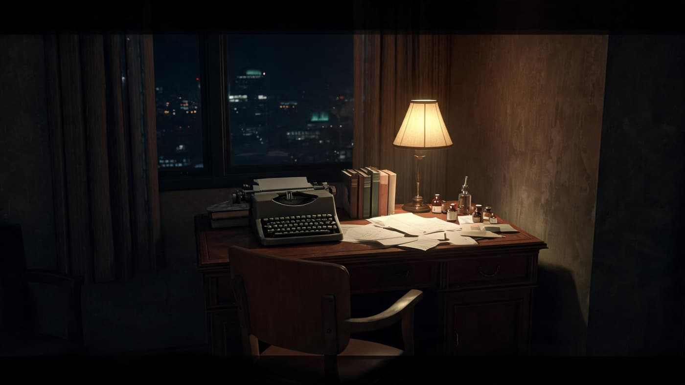
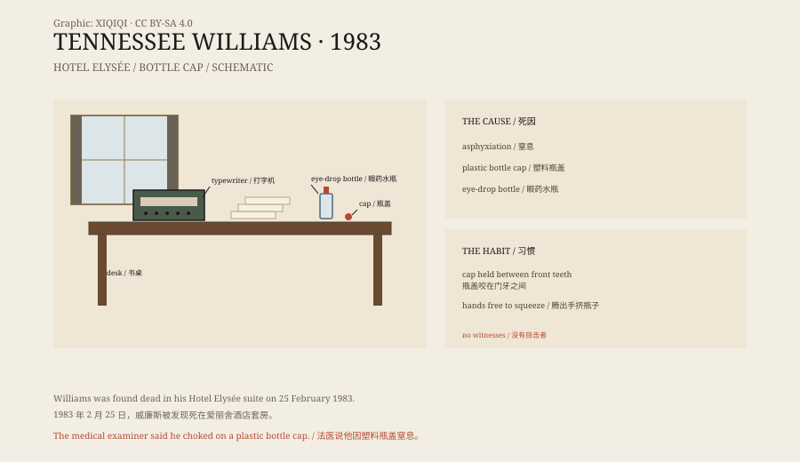

## 1. 25 February 1983

New York, 60 East 54th Street, the Hotel Elysée.

Tennessee Williams had been living there for some time. He treated the hotel as his home, and his room was full of books, medicine bottles, papers, and a typewriter.

On the desk were a lamp, a typewriter, a few books and several medicine bottles. The eye drops were within reach, and the cap was very small.

*Reconstruction: the desk and typewriter in the Hotel Elysée room in 1983. Not a photograph of the scene. XIQIQI Editorial, CC BY-SA 4.0.*

On 25 February he did not appear as usual. Hotel staff opened the door and found him on the floor, not breathing.

He was 71.

## 2. The bottle cap

The medical examiner's initial report said he died of asphyxiation.

A plastic bottle cap was lodged in his throat. It came from the eye-drop bottle he used regularly. He had a habit: while putting in the drops, he held the cap between his upper and lower front teeth so that his hands were free to squeeze the bottle.

This time, the cap slipped down his throat.

The room was quiet. No one heard him cough, and no one was there to help.

Later reports and autopsy records noted that he had also been taking barbiturates. The drugs may have slowed his reactions, so that he could not cough the cap out.

*Original schematic: the timeline of 25 February 1983, the bottle cap and eye-drop bottle, and the layout of the hotel room. Not a photograph of the scene. XIQIQI Editorial, CC BY-SA 4.0.*

## 3. His life

Tennessee Williams was born Thomas Lanier Williams in Mississippi in 1911.

He wrote The Glass Menagerie, A Streetcar Named Desire, and Cat on a Hot Tin Roof. These plays made him famous on Broadway and won him Pulitzer Prizes. His characters struggle with desire, memory, and failure.

In his later years his work was no longer as popular. He depended on alcohol and drugs, suffered from depression, and was hospitalised several times. He kept writing, but critics grew colder towards his new plays.

## 4. The question

The most puzzling thing is not the bottle cap, but why he had it in his mouth.

He lived alone, and there were no signs of a struggle. The police did not suspect murder. The medical examiner concluded accidental asphyxiation.

But why would a 71-year-old man hold a bottle cap between his teeth while using eye drops? Was it habit, a tremor, or the drugs? There is no certain answer.

His death became a strange full stop: a playwright who wrote about desire and failure was carried off by a small piece of plastic.

A few grams of plastic outweighed a lifetime of lines.

## 5. Afterwards

He was buried in St. Louis.

His plays are still performed. The line from A Streetcar Named Desire — “I have always depended on the kindness of strangers” — became one of the most quoted lines in English.

The Hotel Elysée is still open. The room he lived in was later turned into a suite named after him.

## 6. Now

Today, Tennessee Williams's death is still told as a curiosity, a “writer's death”.

But it is also a reminder that a life can fill a stage and still be ended by something tiny. One bottle cap, one breath, one second.

## Timeline

- **1911**: Tennessee Williams was born Thomas Lanier Williams in Mississippi in 1911.

## Sources and evidence

The factual base of this entry rests on 2 independent source(s). S1 (CBS New York) covers the relevant institutional record.
S2 (Mental Floss) provides cross-checks on related records.
The original illustrations are scene reconstructions, diagrams, or maps, not historical photographs. The text separates documented record, later interpretation, and folklore; where sources disagree, the disagreement is left visible rather than smoothed away.

## Limits of the record

Official records, witness testimony, and later retellings are shaped by interests and memory. The more famous the story, the easier it is to mistake later additions for original fact.
The archive keeps the recording and the unanswered question side by side.
In credibility terms, this entry is marked 'verified'. The label describes the present state of evidence, not a final verdict on the story; it should change when new archival material appears.

## Archival note

The following note preserves archival sides of the story that the main text does not expand: provenance, technical detail, and aftermath.
"Tennessee" is his pen name.

He didn't want to use his original name and didn't want his family to be implicated. The pen name comes from his father's Tennessee roots.

"Tennessee" is a pen name.

It comes from the father's Tennessee heritage. Williams did not want to use his original name and did not want his family to be implicated.
After Williams' death, his drama continued.

"The Glass Menagerie" is still being performed, and "A Streetcar Named Desire" is still being adapted. The South he wrote about has changed; the people he wrote about are still there.

The characters he writes are always escaping from their families and always returning to their families. The South on the stage is more real than the South on the map.

He writes about the South and himself. The family on stage is more real than reality.

The South on the stage is more real than the South on the map.
Williams died in a New York hotel on February 25, 1983.

The official story was suffocation and the cause was a bottle cap. He was filling a bottle cap with medicine and it fell into his throat.

There are many versions of Williams' death.

Some said he drank wine and took medicine; some said the bottle cap got stuck in his throat; some said he died alone in the hotel.

There are many versions of Williams' death.

Bottle caps, drugs, alcohol, it's all possible. The autopsy report did not fully explain.
Williams wrote many plays.

"The Glass Menagerie", "A Streetcar Named Desire", "Cat on a Hot Tin Roof" and "Summer and Smoke". He writes about the South, family, desire, loneliness, and violence.

"The Glass Menagerie" is a memory play.

"A Streetcar Named Desire" is about sisters, desire and violence.

Cat on a Hot Tin Roof is about family, lies and legacy.

Williams' play is highly autobiographical.

Laura in "The Glass Menagerie" is based on his sister. Blanche in "A Streetcar Named Desire" has his shadow.

---

**Sources and licenses**: the factual sources are listed in the source ledger S1–S3 at the bottom of this entry. Text and original diagrams are licensed under CC BY-SA 4.0. This article separates the discovery of the death, the medical findings, his life, and the aftermath; the eye-drop bottle cap and accidental asphyxiation are supported by public reports, but there were no witnesses to the moment the cap entered his throat.
