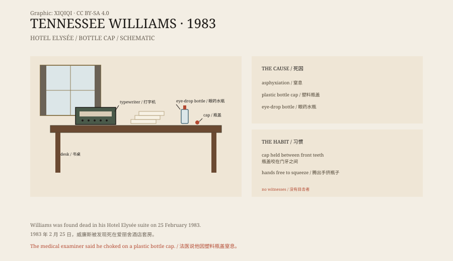

## 一、1983 年 2 月 25 日

纽约，东五十四街 60 号，爱丽舍酒店。

田纳西·威廉斯住在这里已经有一段时间。他把酒店当作家，房间里堆着书、药瓶、纸和打字机。

桌上有一盏台灯、一台打字机、几本书和几个药瓶。眼药水放在手边，瓶盖很小。

*场景复原：1983 年爱丽舍酒店房间里的书桌与打字机。不是现场照片。稀奇奇编辑部，CC BY-SA 4.0。*

2 月 25 日，他没有像往常一样出现。酒店的人打开房门，发现他倒在地上，已经没有呼吸。

他 71 岁。

## 二、瓶盖

法医的初步报告说，他死于窒息。

一个塑料瓶盖卡在他的喉咙里。瓶盖来自他常用的眼药水瓶。他有一个习惯：点眼药水时，把瓶盖咬在上下门牙之间，腾出手来挤瓶子。

那一次，瓶盖滑进了喉咙。

房间很安静。没有人听见他咳嗽，也没有人帮他。

后来的报道和尸检记录提到，他当时还在服用巴比妥类药物。药物可能让他反应变慢，没能把瓶盖咳出来。

*原创示意图：1983 年 2 月 25 日的时间线、瓶盖与眼药水瓶、酒店房间布局。不是现场照片。稀奇奇编辑部，CC BY-SA 4.0。*

## 三、他的一生

田纳西·威廉斯原名托马斯·拉尼尔·威廉斯，1911 年生于密西西比。

他写过《玻璃动物园》《欲望号街车》《热铁皮屋顶上的猫》。这些戏让他在百老汇成名，也让他拿到普利策奖。他笔下的人物，常常在欲望、记忆和失败之间挣扎。

晚年，他的创作不再像从前那样受欢迎。他依赖酒精和药物，情绪低落，多次住院。他仍然写作，但评论界对他的新戏越来越冷淡。

## 四、疑问

这件事最让人不解的，不是瓶盖，而是他为什么会把瓶盖放进嘴里。

他自己一个人住，房间没有打斗的痕迹。警方没有怀疑他杀。法医的结论是意外窒息。

但一个 71 岁的老人，为什么会在点眼药水时咬住瓶盖？是习惯，是手抖，还是药物影响？这些都没有确切答案。

他的死，成了一个奇怪的句号：一个写尽人间欲望和失败的剧作家，最后被一个小小的塑料盖带走了。

一个几克重的瓶盖，抵得过一生的台词。

## 五、之后

他被安葬在圣路易斯。

他的剧作继续上演。《欲望号街车》里的那句“我总是依赖陌生人的善意”，成了英语里最常被引用的台词之一。

爱丽舍酒店还在营业。他住过的房间，后来被改成了以他命名的套房。

## 六、现在

今天，田纳西·威廉斯的死仍然被当作“作家之死”的奇闻来讲述。

但它也是一个提醒：一个人的一生可以写满舞台，结局却可能只由一件极小的事决定。一个瓶盖，一次呼吸，一秒钟。

---

**来源与许可**：本文的事实来源见条目底部来源台账 S1–S3。文字与原创示意图采用 CC BY-SA 4.0。文中把死亡发现、法医结论、生平与后续分开叙述；瓶盖来自眼药水瓶、死因为意外窒息，均有公开报道支持，但瓶盖进入喉咙的具体过程没有目击者。
