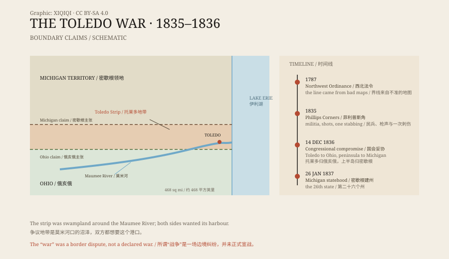

## 1. A line drawn from bad maps

In 1787, the U.S. Congress passed the Northwest Ordinance, which set out how new states would be carved from the land between the Great Lakes. The boundary, it said, would run from the southern tip of Lake Michigan east to Lake Erie.

The maps of the time were wrong. Surveyors assumed the line would hit Lake Erie farther north. By that reading, Toledo and the mouth of the Maumee River belonged to the Michigan Territory. Ohio produced its own survey, which put the line farther south, with Toledo inside Ohio.

Both sides had maps to back them up. What they were arguing over was a stretch of swamp and a small harbour — the Maumee's mouth was one of the few natural ports on that coast.

## 2. The standoff of 1835

In 1835, Ohio's governor, Robert Lucas, decided to settle the matter. He organised a new county in the disputed strip and sent surveyors to mark the line.

Michigan's governor, Stevens T. Mason, was twenty-two years old. He answered by sending militia to stop the Ohio survey.

On 26 April, at Phillips Corners, fifty or sixty Michigan militiamen intercepted the Ohio party. They fired, mostly over the surveyors' heads. The Ohio men were disarmed, held, and then released.

It was the closest thing to a battle in the whole affair.

*Original schematic: the Toledo Strip, the two boundary claims, and the key dates of 1835–1836. Not a historical map. Oddity Archive, CC BY-SA 4.0.*

## 3. The only man who bled

Only one person was actually hurt.

In July 1835, a Michigan deputy sheriff, Joseph Wood, went to Toledo to arrest a local man named Benjamin Stickney. A scuffle broke out in the street. Stickney's son — nicknamed “Two Stickney” — pulled out a penknife and stabbed Wood in the thigh.

The wound was not deep, and Wood survived. It was the only bloodshed of the Toledo War.

Michigan demanded that Ohio hand the younger Stickney over. Ohio refused. Both sides kept their militia in the field and set up camps along the border.

## 4. How Congress settled it

The deadlock lasted more than a year.

The Michigan Territory was short of money and eager for statehood. Without Congress, it could not receive federal funds or join the Union.

On 14 December 1836, Michigan accepted a compromise: the Toledo Strip went to Ohio, and Michigan received a large tract south of Lake Superior — today's Upper Peninsula. On 26 January 1837, Michigan became the twenty-sixth state.

## 5. Who won

On the map, Ohio got the port it wanted.

But the Upper Peninsula later turned out to hold copper and iron. In the second half of the nineteenth century, its mines produced enormous quantities of ore. Michigan made money from its consolation prize; Ohio got a town that grew into an industrial city.

Both states claim victory. The war killed no one.

## 6. Now

Today the Ohio–Michigan line is still there.

It runs through fields, woods, and roads, with no fence and no guard post. Drivers cross it and watch the state name change on their phones.

The name “Toledo War” came later. Toledo was not incorporated until 1837, and the conflict was closer to a border dispute that dragged on for a year. But the name stuck, along with the deputy sheriff who was stabbed with a penknife.

---

**Sources and licenses**: the factual sources are listed in the source ledger S1–S3 at the bottom of this entry. Text and original diagrams are licensed under CC BY-SA 4.0. This article separates the boundary dispute, the militia standoff, the stabbing, and the congressional compromise; “war” is the conventional name, and no deaths were recorded.
