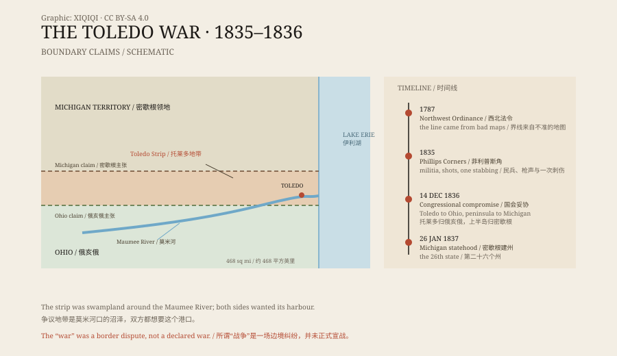

## 一、一条画错的线

1787 年，美国国会通过《西北法令》，要在五大湖之间划出新州的边界。法令说，界线从密歇根湖南端向东，画到伊利湖。

问题是，当时的地图不准。测量的人以为这条线会落在伊利湖偏北的位置。按那条线，托莱多和莫米河河口属于密歇根领地。可俄亥俄州拿出自己的测量结果，说界线应该更靠南，托莱多归俄亥俄。

两边的地图都画得有模有样。争的其实是一片沼泽和一个小港口——莫米河入湖的地方，是这一带少有的天然良港。

## 二、1835 年的对峙

1835 年，俄亥俄州州长罗伯特·卢卡斯决定把事情做实。他在争议地带组织了新的县，派测量队去重新划线。

密歇根领地的州长史蒂文斯·梅森只有二十二岁。他针锋相对，派民兵去阻止俄亥俄的测量。

4 月 26 日，在菲利普斯角，五六十名密歇根民兵拦住了俄亥俄的测量队。他们开了枪，子弹大多打向空中。测量队被缴了械，人被扣下，随后又放了回去。

这是整场“战争”里最像战斗的一次。

*原创示意图：托莱多地带、双方主张的边界与 1835–1836 年的关键节点。不是历史地图。稀奇奇编辑部，CC BY-SA 4.0。*

## 三、唯一见血的人

真正受伤的只有一个人。

1835 年 7 月，密歇根的副警长约瑟夫·伍德到托莱多，要逮捕当地一个叫本杰明·斯蒂克尼的人。双方在街上扭打起来。斯蒂克尼的儿子——外号“双棍”（Two Stickney）——掏出一把折刀，刺中了伍德的大腿。

伤口不深，伍德活了下来。这是托莱多战争里唯一一次流血。

密歇根要求俄亥俄把人交出来，俄亥俄拒绝。两边继续动员民兵，边境上扎起了营地。

## 四、国会怎么收场

僵局持续了一年多。

密歇根领地当时财政困难，急着建州。没有国会同意，它拿不到联邦拨款，也进不了联邦。

1836 年 12 月 14 日，密歇根接受了国会的妥协：托莱多地带归俄亥俄；作为补偿，密歇根得到苏必利尔湖南岸的大片土地，也就是今天的上半岛。1837 年 1 月 26 日，密歇根成为美国第二十六个州。

## 五、谁赢了

从地图上看，俄亥俄拿到了它想要的港口。

但上半岛后来发现了铜和铁。十九世纪下半叶，那里的矿场产出了大量矿石。密歇根靠这片“补偿地”发了财，俄亥俄得到的则是一座后来长成工业城市的托莱多。

两个州都说自己赢了。这场战争没有死人。

## 六、现在

今天，俄亥俄和密歇根的界线仍然画在那里。

它穿过田野、树林和公路，没有铁丝网，也没有岗哨。开车的人从一条路过去，手机上的州名就变了。

“托莱多战争”这个名字其实是后起的。托莱多直到 1837 年才正式设市，而整场冲突更接近一场持续了一年多的边境纠纷。但名字留了下来，连同那个被折刀刺伤的副警长。

---

**来源与许可**：本文的事实来源见条目底部来源台账 S1–S3。文字与原创示意图采用 CC BY-SA 4.0。文中把边界争议、民兵对峙、伤人与国会妥协分开叙述；“战争”是沿用的俗称，实际没有死亡记录。
