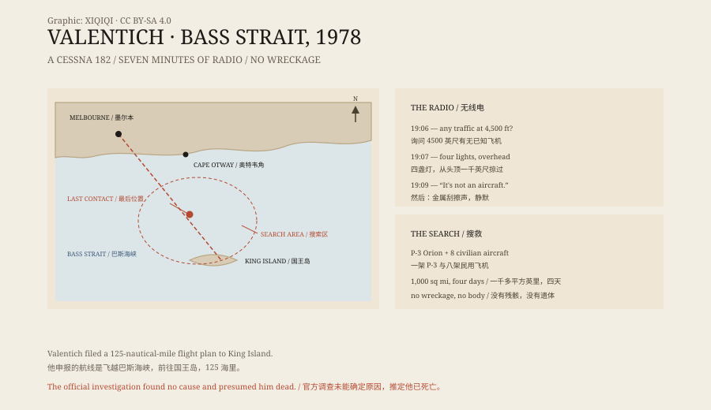

## 1. A night flight

Saturday, 21 October 1978, early evening.

A Cessna 182L took off from Moorabbin Airport near Melbourne, registration VH-DSJ. The pilot was Frederick Valentich, twenty years old. His filed route crossed Bass Strait to King Island, 125 nautical miles, about an hour.

The weather was clear. The controller heard nothing unusual.

## 2. The pilot

Valentich had about 150 hours of flying time and a class-four instrument rating, which allowed him to fly at night, but only in visual meteorological conditions.

He had twice applied to join the Royal Australian Air Force and was rejected both times for inadequate educational qualifications. He studied part-time for a commercial licence and failed all five subjects twice; a month before the flight he failed three more. He had strayed into controlled airspace in Sydney and received a warning, and he had twice deliberately flown into cloud, for which prosecution was being considered.

His father said he believed in UFOs and was afraid of being attacked by them. His girlfriend said that six days before the flight he had talked about the possibility of a UFO taking him away.

## 3. 19:06

At 7:06 pm, Valentich called Melbourne Flight Service and asked whether there was any known traffic at his level, 4,500 feet.

The controller said there was none.

He reported an aircraft above him, with four bright landing lights, which had passed about 1,000 feet overhead at high speed. He said it had a shiny metal surface and a green light, and that it was orbiting above him. He also said his engine had begun running roughly.

The controller asked him to identify the aircraft.

## 4. 19:09

At 19:09:27, Valentich said:

“It's not an aircraft.”

Then came a metallic, scraping sound. Then silence.

## 5. The search

The Royal Australian Air Force sent a P-3 Orion, and eight civilian aircraft joined the search. It covered more than 1,000 square miles.

On 25 October the search was called off. No aircraft, no body, no oil slick, no seat.

Five years later, an engine cowl flap washed ashore on Flinders Island. It was identified as coming from a Cessna 182 within a serial number range that included Valentich's aircraft.

## 6. Explanations

The Department of Transport investigation could not determine the cause. It recorded Valentich as “presumed fatal”.

Some officials speculated that he became disoriented at night and saw his own lights reflected in the water, or lights from a nearby island, while flying upside down.

In 2013, the astronomer James McGaha and the writer Joe Nickell reconstructed a different explanation. Valentich, they argued, was deceived by the illusion of a tilted horizon, tried to correct it, and put the aircraft into a tightening “graveyard spiral” that he mistook for the other craft orbiting him. The G-forces reduced fuel flow, producing the rough running he reported. The four lights, they suggested, were probably Venus, Mars, Mercury and the star Antares.

Others have proposed that he was imitating a scene from the film Close Encounters of the Third Kind, trying to give the radar controllers something to see, and lost control. Some have suggested he staged his own disappearance, since the aircraft still had enough fuel to fly 800 kilometres; but it was never plotted on radar near Cape Otway.

## 7. Now

Forty-eight years later, Bass Strait has given nothing back.

The radio recording is still there. A twenty-year-old man, flying toward an island at night, says one last sentence, and disappears.

*Original schematic: the departure from Moorabbin, the destination at King Island, the radio timeline, and the search area. Not an accident diagram. Oddity Archive, CC BY-SA 4.0.*

---

**Sources and licenses**: the factual sources are listed in the source ledger S1–S3 at the bottom of this entry. Text and original diagrams are licensed under CC BY-SA 4.0. This article separates the radio exchanges, the search, the official finding, and the proposed explanations; the investigation did not determine a cause, and the UFO explanation has no supporting evidence. The illustration is a scene reconstruction, not a historical photograph.
