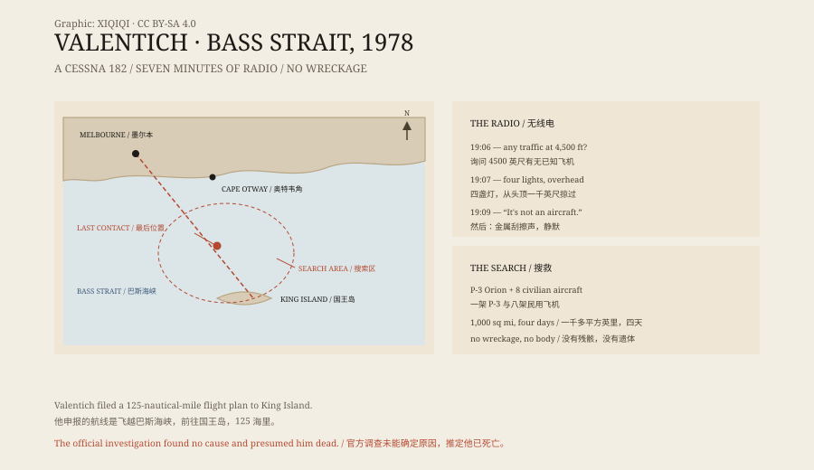

## 一、一次夜间飞行

1978 年 10 月 21 日，星期六，傍晚。

一架塞斯纳 182L 从墨尔本附近的穆拉宾机场起飞，机号 VH-DSJ。飞行员叫弗雷德里克·瓦伦蒂奇，二十岁。他申报的航线是飞越巴斯海峡，前往国王岛，全程 125 海里，大约一小时。

天气晴朗。塔台没有收到任何异常。

## 二、飞行员

瓦伦蒂奇有大约一百五十小时飞行经验，持有四级仪表资格，可以在夜间飞行，但只能在目视气象条件下飞行。

他两次申请加入澳大利亚皇家空军，都因为学历不够被拒。他在业余时间读商业飞行执照的课程，五门科目两次全部没过，一个月前又挂了三门。他曾经飞进悉尼的管制空域，收到警告；还两次故意飞进云里，差点被起诉。

他的父亲说，他相信 UFO，而且害怕被 UFO 攻击。他的女友说，失踪前六天，他跟她聊过“被 UFO 带走”的可能。

## 三、19:06

19 点 06 分，瓦伦蒂奇呼叫墨尔本飞行服务，问 4500 英尺高度有没有已知飞机。

管制员回答：没有。

他说，有一架飞机在他上方，四盏明亮的着陆灯，从他头顶约一千英尺处掠过，速度很快。他说那东西有金属光泽，上面有一盏绿灯，正在他上方盘旋。他还说，发动机开始抖动。

管制员问他能不能确认机型。

## 四、19:09

19 点 09 分 27 秒，瓦伦蒂奇说：

“那不是飞机。”

接着，无线电里传来一阵金属刮擦的声音。然后，静默。

## 五、搜救

澳大利亚皇家空军派出一架 P-3 猎户座，另有八架民用飞机参加搜索。搜索范围超过一千平方英里。

10 月 25 日，搜索停止。没有找到飞机，没有找到人，没有找到油渍或座椅。

五年后，弗林德斯岛的海岸上冲来一块发动机整流罩的检修口盖。它被确认来自一架塞斯纳 182，序列号范围包括瓦伦蒂奇的飞机。

## 六、解释

运输部的调查报告无法确定原因，只写“推定死亡”。

有官员猜测，瓦伦蒂奇在夜间失去了方向感，倒飞时看到自己的灯光映在水面上，或者看到了附近岛屿的灯光。

2013 年，天文学家詹姆斯·麦加哈和作家乔·尼克尔的复盘给出了另一种解释：瓦伦蒂奇遇到了倾斜地平线的错觉，试图修正，结果把飞机带进了越来越紧的“墓地螺旋”。他以为那是“盘旋”。G 力让燃油供应不稳，于是发动机“抖动”。他看到的“四盏灯”，可能是金星、火星、水星和心宿二。

也有人认为，他是在模仿电影《第三类接触》里的场景，想给雷达上的人看点东西，结果失控坠海。还有人认为他自导自演了失踪，因为那架飞机还有足够的油飞很远；但雷达从未在岬角附近捕捉到它。

## 七、现在

四十八年过去，巴斯海峡没有给出任何东西。

那盘无线电录音还在。一个二十岁的年轻人，在夜里飞向一座岛，最后说了一句话，然后消失。

*原创示意图：穆拉宾起飞点、国王岛目的地、无线电通话时间线与搜索海域。不是航空事故图。稀奇奇编辑部，CC BY-SA 4.0。*

---

**来源与许可**：本文的事实来源见条目底部来源台账 S1–S3。文字与原创示意图采用 CC BY-SA 4.0。文中把无线电通话、搜救、官方结论与各种解释分开叙述；官方调查未能确定原因，UFO 说法没有证据支持。插图是场景复原，不是历史照片。
