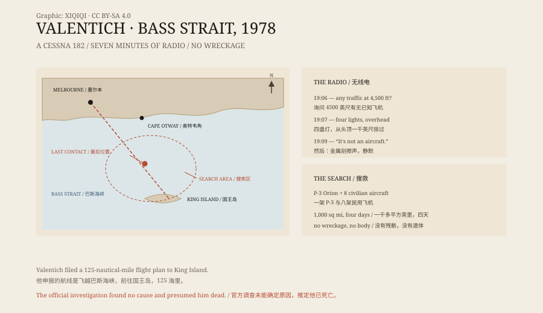

## 一、一次夜间飞行

1978 年 10 月 21 日，星期六，傍晚。

一架塞斯纳 182L 从墨尔本附近的穆拉宾机场起飞，机号 VH-DSJ。飞行员叫弗雷德里克·瓦伦蒂奇，二十岁。他申报的航线是飞越巴斯海峡，前往国王岛，全程 125 海里，大约一小时。

天气晴朗。塔台没有收到任何异常。

## 二、飞行员

瓦伦蒂奇有大约一百五十小时飞行经验，持有四级仪表资格，可以在夜间飞行，但只能在目视气象条件下飞行。

他两次申请加入澳大利亚皇家空军，都因为学历不够被拒。他在业余时间读商业飞行执照的课程，五门科目两次全部没过，一个月前又挂了三门。他曾经飞进悉尼的管制空域，收到警告；还两次故意飞进云里，差点被起诉。

他的父亲说，他相信 UFO，而且害怕被 UFO 攻击。他的女友说，失踪前六天，他跟她聊过“被 UFO 带走”的可能。

## 三、19:06

19 点 06 分，瓦伦蒂奇呼叫墨尔本飞行服务，问 4500 英尺高度有没有已知飞机。

管制员回答：没有。

他说，有一架飞机在他上方，四盏明亮的着陆灯，从他头顶约一千英尺处掠过，速度很快。他说那东西有金属光泽，上面有一盏绿灯，正在他上方盘旋。他还说，发动机开始抖动。

管制员问他能不能确认机型。

## 四、19:09

19 点 09 分 27 秒，瓦伦蒂奇说：

“那不是飞机。”

接着，无线电里传来一阵金属刮擦的声音。然后，静默。

## 五、搜救

澳大利亚皇家空军派出一架 P-3 猎户座，另有八架民用飞机参加搜索。搜索范围超过一千平方英里。

10 月 25 日，搜索停止。没有找到飞机，没有找到人，没有找到油渍或座椅。

五年后，弗林德斯岛的海岸上冲来一块发动机整流罩的检修口盖。它被确认来自一架塞斯纳 182，序列号范围包括瓦伦蒂奇的飞机。

## 六、解释

运输部的调查报告无法确定原因，只写“推定死亡”。

有官员猜测，瓦伦蒂奇在夜间失去了方向感，倒飞时看到自己的灯光映在水面上，或者看到了附近岛屿的灯光。

2013 年，天文学家詹姆斯·麦加哈和作家乔·尼克尔的复盘给出了另一种解释：瓦伦蒂奇遇到了倾斜地平线的错觉，试图修正，结果把飞机带进了越来越紧的“墓地螺旋”。他以为那是“盘旋”。G 力让燃油供应不稳，于是发动机“抖动”。他看到的“四盏灯”，可能是金星、火星、水星和心宿二。

也有人认为，他是在模仿电影《第三类接触》里的场景，想给雷达上的人看点东西，结果失控坠海。还有人认为他自导自演了失踪，因为那架飞机还有足够的油飞很远；但雷达从未在岬角附近捕捉到它。

## 七、现在

四十八年过去，巴斯海峡没有给出任何东西。

那盘无线电录音还在。一个二十岁的年轻人，在夜里飞向一座岛，最后说了一句话，然后消失。

*原创示意图：穆拉宾起飞点、国王岛目的地、无线电通话时间线与搜索海域。不是航空事故图。稀奇奇编辑部，CC BY-SA 4.0。*

## 飞行

1978 年 10 月 21 日，澳大利亚飞行员弗雷德里克·瓦伦蒂奇，从墨尔本起飞。

他驾驶一架塞斯纳飞机，飞往巴斯海峡的国王岛。

## 19:06

19:06，他和地面联系。

他说，有一个“金属物体”在附近。它不是飞机，也不是直升机。

## 19:09

19:09，他说：“它消失了。”

然后，无线电断了。

## 搜救

搜救队搜索了巴斯海峡。

没有找到飞机，没有找到尸体，没有找到残骸。

搜救队搜索了海峡。

没有找到飞机，没有找到尸体，没有找到残骸。

## 解释

解释很多：迷路、坠海、UFO、自杀。

最被接受的是坠海。但没有人找到飞机。

## 现在

瓦伦蒂奇的失踪，成了澳大利亚的 UFO 案例。

他的最后通话，还在档案里。

## 巴斯海峡

巴斯海峡，在澳大利亚大陆和塔斯马尼亚之间。

水冷，风大，浪高。小型飞机飞越海峡，需要经验。

## 飞机

瓦伦蒂奇驾驶的，是一架塞斯纳 182。

飞机很小，能飞几个小时。他没有飞越海峡的经验。

他驾驶的塞斯纳 182，是一架小型飞机。

它没有黑匣子，没有卫星追踪。飞机消失后，只能靠雷达和目击者。

## 塔台

他和墨尔本塔台联系。

他说，有一个“金属物体”在附近。它不是飞机，也不是直升机。

## 补记

瓦伦蒂奇的最后通话，只有几句话。

他说，有一个“金属物体”在附近。它不是飞机。

然后，他说：“它消失了。”

## 终记

瓦伦蒂奇的最后通话，只有几句话。

他说，有一个“金属物体”在附近。

然后，他说：“它消失了。”

## 末记

他 1978 年 10 月 21 日失踪。飞机没有黑匣子，没有卫星追踪。最后的话，只有塔台录音。

他的飞机，至今没有找到。塔台录音，成了唯一的证词。

他没有留下尸体，也没有留下飞机。他只留下了一段录音，和一句“它消失了”。海面平静，像什么也没有发生。

海还在。

海面平静，问题还在。

## 档案

1978 年 10 月 21 日，瓦伦蒂奇的飞机在 Bass 海峡失踪。塔台最后一次通话，只有几句话。搜救持续了几天，没有找到飞机，也没有找到尸体。

他驾驶的是一架轻型飞机，型号是 Cessna 182。飞机没有雷达应答机。

他的飞行计划是从墨尔本飞往国王岛。最后通话后，雷达上没有了目标。

国王岛的空管，也没有再收到他的呼叫。

他的飞机上，没有黑匣子。搜救队只找到一些油迹。

他失踪前，和女友通过电话。他说，他马上回来。他的女友后来说，电话里没有异常。她等了很久，才等到失踪的消息。

他的失踪，成了澳大利亚航空史的一页。

---

**来源与许可**：本文的事实来源见条目底部来源台账 S1–S3。文字与原创示意图采用 CC BY-SA 4.0。文中把无线电通话、搜救、官方结论与各种解释分开叙述；官方调查未能确定原因，UFO 说法没有证据支持。插图是场景复原，不是历史照片。
