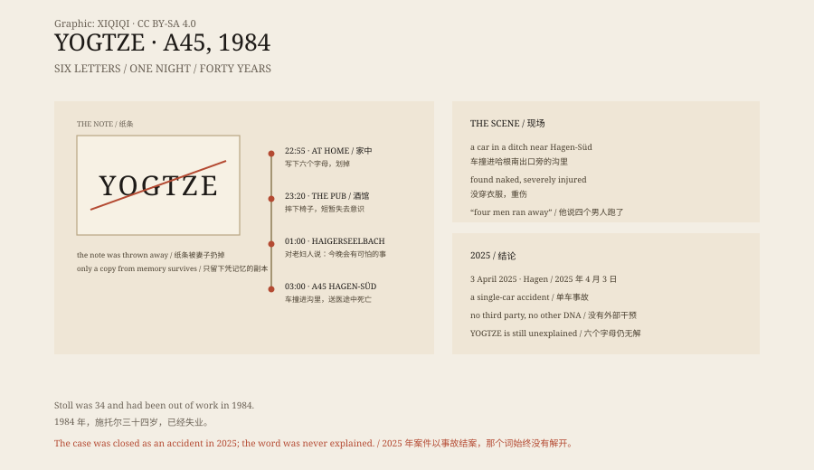

## 1. 25 October 1984

Günter Stoll was thirty-four and lived in Anzhausen, in the German state of North Rhine-Westphalia. He had worked as a food industry technician and was unemployed in 1984.

Neighbours described him as a quiet man. His wife said that in the preceding months something had been wrong. He believed that “they” were watching him, following him, planning to harm him. When his wife asked who “they” were, he never said.

On the evening of 25 October, shortly before eleven, he was sitting in an armchair in the bedroom. He suddenly stood up and said, loudly, “Now I've got it.”

Then he took a piece of paper and wrote six letters: YOGTZE. When he had written them, he crossed them out.

## 2. The pub

He left the house and drove to his regular pub in Wilnsdorf.

He ordered a beer. Before he could drink it, he fell off his chair and hit his face on the floor. The people in the pub helped him up. He said he had “suddenly gone”. No one thought he had been drinking.

He left soon afterwards and drove away in his light blue VW Golf I.

## 3. One in the morning

At about one in the morning he appeared in Haigerseelbach, where he had grown up.

He knocked at the door of an elderly woman, a religious neighbour from the area around his parents' house. He told her, “Something is going to happen tonight, something pretty terrifying.”

She saw how disturbed he was and advised him to go to his parents' house and talk to them. He refused, saying they would not understand. He said he would go home and speak to his wife. Then he left.

## 4. The A45

At about three in the morning, two truck drivers saw a car in a ditch beside the A45, near the Hagen-Süd exit.

One driver went to call the police. The other walked over, looked inside, and found Stoll in the car, badly injured and naked.

He was still conscious. He said that four men had been in the car with him, and that they had run away. The driver asked whether they were his friends. He said no.

He died on the way to the hospital.

## 5. The note

The police quickly concluded that this was not an ordinary crash.

His injuries did not match the way the car had hit the trees. He might have been run over somewhere else and then placed in the car and driven to Hagen-Süd. Why he had no clothes on was another question without an answer.

There were other witnesses. Someone saw a hitchhiker near the exit. Someone saw a pickup truck. Neither was ever identified. The four men Stoll described were never found.

The sheet of paper with YOGTZE on it was thrown away by his wife that night. Investigators had only a copy made from memory.

YOGTZE is not a German word, or a word in any other language. Someone suggested that the G was really a 6, and that YO6TZE was the call sign of a Romanian radio station. The idea never connected to anything that happened that night.

*Original schematic: the positions of Anzhausen, Wilnsdorf, Haigerseelbach and the Hagen-Süd exit on the A45, and the YOGTZE note. Not a photograph of the scene. Oddity Archive, CC BY-SA 4.0.*

## 6. Forty years

In April 1985 the case was shown on the German television programme Aktenzeichen XY … ungelöst.

After the broadcast, leads came in from all over the country. The police followed more than 1,200 of them, and none pointed to a killer. The case became one of Germany's best-known unsolved mysteries, and YOGTZE became a symbol with no answer.

Every few years someone reopens it. Some say murder. Some say intelligence services. Some say aliens. Some say he wrote a code to himself.

## 7. April 2025

On 3 April 2025, the public prosecutor's office and the police in Hagen held a press conference.

They announced that Stoll had not been killed. His death was a single-car accident caused by his own driving.

New expert reports reconstructed what happened. He was not wearing a seatbelt. The car left the A45, hit trees, and he was thrown back into the driver's seat, where he was later found. There was no DNA in the car other than his own. The “four men” were the words of a severely injured man in a state of severe psychological disturbance.

Forty years of murder investigation ended there.

## 8. The word

The case is closed. The word is not.

YOGTZE belongs to no language and has left no verifiable meaning. It is six letters written late at night by one man, and then crossed out.

What he understood that night, no one knows.

---

**Sources and licenses**: the factual sources are listed in the source ledger S1–S3 at the bottom of this entry. Text and original diagrams are licensed under CC BY-SA 4.0. This article separates the movements of that night, the crash scene, the note, and the investigation; in April 2025 the Hagen prosecutor's office and police concluded that the death was a single-car accident, and the meaning of YOGTZE remains unexplained. The illustration is a scene reconstruction, not a historical photograph.
