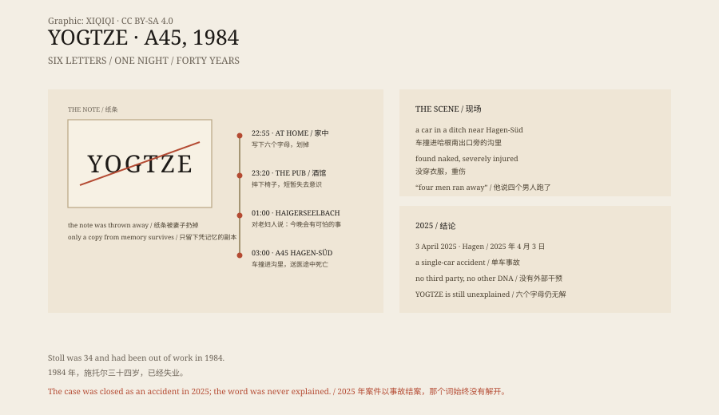

## 一、1984 年 10 月 25 日

京特·施托尔，三十四岁，住在德国北莱茵-威斯特法伦州的安茨豪森。他做过食品行业的技术员，1984 年失业在家。

邻居说他是个安静的人。他的妻子说，那几个月他不太对劲。他总觉得“他们”在盯着他，在跟踪他，要对他做点什么。妻子问“他们”是谁，他从不说明。

10 月 25 日晚上，快到十一点，他坐在卧室的扶手椅上，突然站起来，大声说了一句：“我现在明白了。”

然后他拿起纸笔，写下六个字母：YOGTZE。写完，又把它划掉。

## 二、酒馆

他出门，开车去了维尔恩斯多夫常去的那家酒馆。

他点了一杯啤酒。还没来得及喝，他从椅子上摔了下去，脸磕在地上。酒馆里的人把他扶起来，他说自己“突然就过去了”。有人闻到他身上没有酒味。

他很快离开，开着他那辆浅蓝色的高尔夫一号走了。

## 三、凌晨一点

凌晨一点左右，他出现在海格斯埃尔巴赫——他小时候住的地方。

他敲开一位老妇人的门。她是他父母家附近的邻居，很虔诚。他对她说：“今晚会发生一件事，一件很可怕的事。”

老妇人看他神色不对，劝他回父母家谈谈。他拒绝了，说他们不会理解。他说他要回家，跟妻子说。然后他走了。

## 四、A45

凌晨三点左右，两名卡车司机在 A45 高速公路哈根南出口附近，看见一辆车撞在路边的沟里。

一个司机去报警。另一个走过去，往车里看，发现施托尔躺在里面，伤得很重，没有穿衣服。

他还有意识。他说，车里有四个男人，他们跑了。司机问他，那是你的朋友吗？他说不是。

在去医院的路上，他死了。

## 五、纸条

警方很快发现，这不是一起普通的车祸。

他的伤和车撞树的方式对不上。他可能是先在别处被车碾过，然后被人放进车里，开到哈根南。为什么没穿衣服，也说不通。

还有别的目击者：有人在出口附近看见一个搭便车的人，有人看见一辆皮卡。两个人都没有找到。施托尔说过的“四个男人”，也没有找到。

那张写着 YOGTZE 的纸，被他的妻子在当晚扔掉了。调查人员只拿到一份凭记忆复写的副本。

YOGTZE 不是德语，也不是任何语言里的词。有人猜，那个 G 其实是一个 6，YO6TZE 是罗马尼亚一家广播电台的呼号。但这条线索和当晚发生的事对不上。

*原创示意图：安茨豪森、维尔恩斯多夫、海格斯埃尔巴赫与 A45 哈根南出口的位置关系，以及 YOGTZE 纸条。不是现场照片。稀奇奇编辑部，CC BY-SA 4.0。*

## 六、四十年

1985 年 4 月，这起案子上了德国电视节目《案号 XY……未解》。

节目播出后，线索从各地涌来。警方查了一千二百多条，没有一条能指向凶手。案子成了德国最出名的悬案之一，YOGTZE 成了一个没有答案的符号。

每年都有人重新翻出它。有人说是谋杀，有人说是情报机构，有人说是外星人，有人说是他自己写的暗号。

## 七、2025 年 4 月

2025 年 4 月 3 日，哈根检察院和警方召开新闻发布会。

他们宣布：施托尔不是被杀的。这是一场他自己造成的单车事故。

新的专家报告重建了过程：他没有系安全带，车在 A45 上冲出路面，撞上树木，他被抛回驾驶座，就是后来被发现的位置。车里没有别人的 DNA。他说的“四个男人”，是一个受重伤、精神状况严重异常的人在混乱中说出的话。

四十年的谋杀调查，就这样结束了。

## 八、词

案子结了，词没有解开。

YOGTZE 不属于任何语言，也没有留下任何可验证的含义。它只是一个人在深夜写下的六个字母，写完又划掉。

那一晚他到底明白了什么，没有人知道。

---

**来源与许可**：本文的事实来源见条目底部来源台账 S1–S3。文字与原创示意图采用 CC BY-SA 4.0。文中把当晚行踪、车祸现场、纸条与调查结论分开叙述；2025 年 4 月哈根检察院与警方认定这是一起单车事故，YOGTZE 的含义仍未得到解释。插图是场景复原，不是历史照片。
